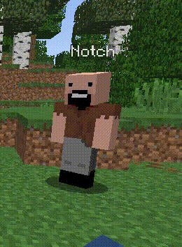

# ScoreboardAPI

**Client-side player identities for Paper.** Change a player's visible name, skin, official cape, chat name, and nametag without changing their real account identity on the server.

**Version:** 1.1.0 &nbsp; | &nbsp; **Minecraft / Paper:** 26.3 &nbsp; | &nbsp; **Java:** 25 &nbsp; | &nbsp; **PacketEvents:** 2.14.0

<p align="center">
  
  <br />
  <sub>In-game preview of a changed player identity.</sub>
</p>

## Overview

ScoreboardAPI separates a player's **real identity** from the identity shown to other clients. It works at the packet level for profile names and textures, uses client-side scoreboard teams for nametags, and provides a dedicated chat renderer.

- **Visual nicknames.** Change the name above a player and, optionally, in the player list.
- **Skins and official capes.** Apply the target account's signed Mojang textures, including its active cape when available.
- **Disguises.** Use one command to combine a visible name, skin, cape, and optional chat / TAB changes.
- **Prefixes and suffixes.** Add nametag decorations independently of skins and nicknames.
- **Chat aliases.** Format chat with MiniMessage without replacing the signed message content.
- **Plugin API.** Manage appearances from other plugins through Bukkit's `ServicesManager`.
- **Persistence.** Store settings by the player's real UUID in `players.yml`.

The distinction matters: `Player#getName()` and `Player#getUniqueId()` continue to return the original values. ScoreboardAPI changes what clients *see*, not who the server *recognizes*.

## Quick start

### Requirements

| Component | Version |
| --- | --- |
| Paper | **26.3** |
| Java | **25** |
| PacketEvents (Spigot/Paper build) | **2.14.0** |

PacketEvents is a **required server plugin**. It is not bundled into ScoreboardAPI; the Gradle project uses `compileOnly` dependencies.

### Installation

1. Install [PacketEvents 2.14.0 for Spigot/Paper](https://modrinth.com/plugin/packetevents/version/2.14.0%2Bspigot) in your server's `plugins/` directory.
2. Copy `ScoreboardAPI-1.1.0.jar` into the same directory. Use `libs/ScoreboardAPI-1.1.0.jar` if the prebuilt JAR is included in the repository, or build it from source using the instructions below.
3. Start the server on Java 25. ScoreboardAPI creates `plugins/ScoreboardAPI/config.yml` on first launch.
4. Grant the relevant `scoreboardapi.*` permissions, or test as a server operator.

Example server layout:

```text
server/
  plugins/
    packetevents-spigot-2.14.0.jar
    ScoreboardAPI-1.1.0.jar
```

Skin and cape lookups require outbound HTTPS access to `api.mojang.com` and `sessionserver.mojang.com`.

### First commands

```text
/sba nick Notch
/sba prefix [HASA]
/sba suffix [VIP]
/sba disguise Notch
/sba undisguise
```

With the default settings, `/sba disguise Notch` updates the player's visible nickname, skin, active official cape (if present), chat name, and TAB name. Existing prefix and suffix values are preserved. `/sba undisguise` removes the disguise and restores any independently configured values.

## Commands

| Command | Description | Permission |
| --- | --- | --- |
| `/sba nick <account> [player]` | Set a visual nickname; also apply its skin by default | `scoreboardapi.nick` |
| `/sba skin <account> [player]` | Apply the account's signed textures without changing the name | `scoreboardapi.skin` |
| `/sba chat <name> [player]` | Set the name shown by the chat renderer | `scoreboardapi.chat` |
| `/sba prefix <text> [--player player]` | Set a nametag/chat prefix | `scoreboardapi.prefix` |
| `/sba suffix <text> [--player player]` | Set a nametag/chat suffix | `scoreboardapi.suffix` |
| `/sba disguise <account> [player]` | Apply a combined visual disguise | `scoreboardapi.disguise` |
| `/sba undisguise [player]` | Remove the disguise, retaining manually set values | `scoreboardapi.undisguise` |
| `/sba reset <field> [player]` | Reset `nick`, `skin`, `chat`, `prefix`, `suffix`, or `all` | `scoreboardapi.reset` |
| `/sba reload` | Reload the plugin configuration | `scoreboardapi.reload` |

To target another online player, also grant `scoreboardapi.others`. The `player` argument uses the **real Minecraft username**, not the visual nickname. Commands default to the executing player when no target is supplied; console usage requires a target. Permissions default to server operators.

Prefix and suffix values are currently plain text (default limit: 32 characters); MiniMessage formatting applies to the **chat template**, not to the user-supplied prefix/suffix strings.

## Configuration

The default configuration lives in [`src/main/resources/config.yml`](src/main/resources/config.yml). Edit the generated copy at `plugins/ScoreboardAPI/config.yml` on the server, then run `/sba reload`.

```yaml
settings:
  change-skin-with-nickname: true
  update-tab-list: true
  persist-player-settings: true
  max-affix-length: 32

chat:
  enabled: true
  format: '<gray>{prefix}<white>{name}</white>{suffix}<dark_gray>: </dark_gray>{message}'

nametag:
  enabled: true

disguise:
  enabled: true
  change-nametag: true
  change-chat: true
  change-tab: true
  copy-target-textures: true
  preserve-prefix-suffix: true
  persist: true
```

Chat supports `{prefix}`, `{suffix}`, `{name}`, `{real_name}`, and `{message}`. User-provided values are inserted as literal components; they are not parsed as MiniMessage tags.

When `change-skin-with-nickname` is enabled, `/sba nick` also applies the named account's skin. An explicitly selected `/sba skin` takes precedence. Disguises are a separate overlay: removing one reveals the prior manual settings instead of resetting everything.

## Developer API

The public interface is `it.farrlor.scoreboardapi.api.ScoreboardApi`, registered with Bukkit's `ServicesManager`.

```java
import it.farrlor.scoreboardapi.api.ScoreboardApi;
import org.bukkit.Bukkit;
import org.bukkit.entity.Player;

public void disguisePlayer(Player player) {
    ScoreboardApi api = Bukkit.getServicesManager().load(ScoreboardApi.class);
    if (api == null) return;

    api.setPrefix(player.getUniqueId(), "[HASA]");
    api.disguise(player.getUniqueId(), "Notch")
        .exceptionally(error -> {
            Bukkit.getLogger().warning("Disguise failed: " + error.getMessage());
            return null;
        });
}
```

Call mutation methods on the main server thread. Operations that fetch Mojang textures are asynchronous and return `CompletableFuture` values; production integrations should handle failures. Add `depend: [ScoreboardAPI]` or `softdepend: [ScoreboardAPI]` to the consuming plugin's `plugin.yml` as appropriate.

See [API documentation](docs/API.md) for the method list, lifecycle, and a complete example.

## Build from source

The project uses Gradle Kotlin DSL and the Gradle wrapper. No manually installed Paper or PacketEvents JARs are needed for compilation.

```bash
./gradlew build
```

On Windows:

```powershell
.\gradlew.bat build
```

The resulting artifact is `build/libs/ScoreboardAPI-1.1.0.jar`. Unit tests run as part of `build`.

## Compatibility and limitations

- **Paper 26.3 only.** Other Minecraft server versions and implementations are not part of the current compatibility target.
- **Visual change only.** Server permissions, UUID, real username, and authentication remain unchanged. Signed chat can still identify the original sender; a chat alias is not a cryptographic identity change.
- **Official capes.** ScoreboardAPI uses the active cape included in Mojang's signed `textures` property. Mod-specific capes (OptiFine, Lunar Client, etc.) are outside its scope. Client settings can affect cape visibility.
- **Scoreboard ownership.** Minecraft clients allow one team per entry. Plugins such as TAB or other nametag managers may conflict when they also control the same player's team.
- **Client refresh and caching.** The plugin refreshes player information and visible entities, but changes to rendering, tracking, and client-side texture caches should be tested with real players.
- **Network dependency.** Uncached skins/disguises depend on Mojang services. Failed lookups do not intentionally replace the existing appearance.


---

**Documentation:** [Public API](docs/API.md) | [Default configuration](src/main/resources/config.yml)
